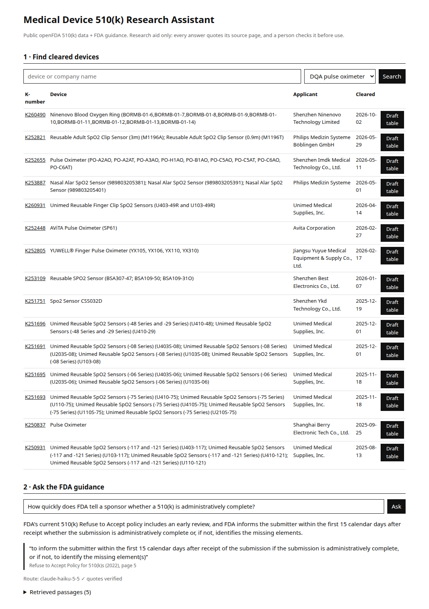

# Medical Device 510(k) Research Assistant

A small full-stack research aid for medical device regulatory work, built on public FDA data:

- **ETL pipeline**: openFDA 510(k) clearances for 5 product codes (pulse oximeters, glucose meters, infusion pumps, blood pressure systems, ECG electrodes) → cleaned → **PostgreSQL** (3,646 rows).
- **RAG over FDA guidance**: 3 public guidance PDFs (510(k) substantial equivalence, Refuse to Accept policy, device software functions) → page-level chunks + pgvector embeddings.
- **Traceable answers**: every answer quotes a sentence **word for word** from a named guidance page. A deterministic checker rejects any quote it cannot find in the cited page; no unverified quote is ever shown.
- **Model routing**: Claude Haiku 5.5 answers first; only a failed quote check escalates to Claude Opus 5.5; every call is logged with its cost and stops at a budget.
- **Draft predicate table**: for a K-number, a markdown table of earlier same-code clearances, every row linked to its FDA record, marked DRAFT for human review.
- **FastAPI** backend + **React / TypeScript** page.

> Research aid only, not regulatory advice. A person checks every output.

<a href="https://dheepakkaran.github.io/medical-device-510k-assistant/#overview"></a>

<sub>35-second overview (silent preview). <a href="https://dheepakkaran.github.io/medical-device-510k-assistant/#overview">Watch it with sound on the project page →</a></sub>

Project page: https://dheepakkaran.github.io/medical-device-510k-assistant/



## Results (from `RESULTS.md`, built from `results/*.json`)

| | |
|---|---|
| Retrieval, 20 frozen questions, hit@3 | keyword **16/20** · embedding 14/20 · hybrid 14/20 |
| Cascade answers with every quote verified | **20/20** (19 answered, 1 "not found") |
| Answers citing the labelled page | 15/20 (17/20 counting repeated checklist pages, see FAILURES.md) |
| Out-of-scope questions answered | **0/3** (correctly refused) |
| Opus-only ablation on q01–q10 | same page accuracy (5/10), **$0.161 vs $0.0039** for the cascade |
| Total API spend, all runs | **$0.17** |

The plain keyword baseline won retrieval. That result is reported as is; see [FAILURES.md](FAILURES.md).

## Run it

```bash
# database: PostgreSQL + pgvector without Docker (pixi), or `docker compose up db`
scripts/db.sh start
uv sync
uv run python etl/devices.py      # openFDA → devices
# download the 3 guidance PDFs into data/guidance/ (URLs in etl/guidance.py), then:
uv run python etl/guidance.py     # PDFs → chunks + embeddings
cp .env.example .env              # optional ANTHROPIC_API_KEY; without it /api/ask returns the cited passages only
(cd web && npm ci && npm run build)
uv run uvicorn app.main:app       # http://localhost:8000
uv run pytest -q                  # 13 tests
```

Docker: `docker compose up --build`, then run the two ETL scripts with `docker compose run api python etl/devices.py` (and `etl/guidance.py`).

## API

| Endpoint | What |
|---|---|
| `GET /api/devices?q=&product_code=DQA` | search cleared devices |
| `GET /api/devices/{k_number}` | one device with its FDA source link |
| `POST /api/ask {"question": ...}` | cited answer + route (models tried, check result) + retrieved passages |
| `GET /api/report/{k_number}` | draft predicate comparison table (markdown) |
| `GET /api/health` | row counts |

## Evaluation

- `eval/questions.jsonl`: 20 questions with the gold guidance doc + page, written and hashed (`eval/questions.sha256`) **before** any retrieval run; committed first.
- `eval/negatives.jsonl`: 3 questions the guidance cannot answer.
- `eval/run_retrieval.py` → `results/retrieval.json`; `eval/run_answers.py` → `results/answers.json` + `results/cost_ledger.jsonl`; `scripts/make_results.py` → `RESULTS.md`.

## Layout

```
etl/        devices.py (openFDA ETL), guidance.py (PDF chunks + embeddings)
app/        main.py (FastAPI), retrieve.py (keyword / vector / hybrid), answer.py (routing + ledger), cite.py (quote checker), db.py
prompts/    answer_v1.txt
web/        React + TypeScript (Vite)
eval/       frozen questions + runners
results/    every measured number
tests/      ETL, citation checker, routing (fake model), API
```

Data: openFDA (public domain, "do not rely on openFDA to make decisions regarding medical care") and FDA guidance documents (public).
